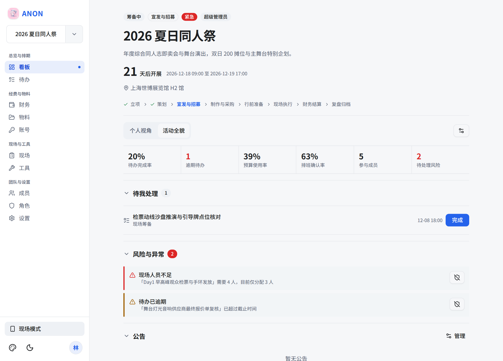
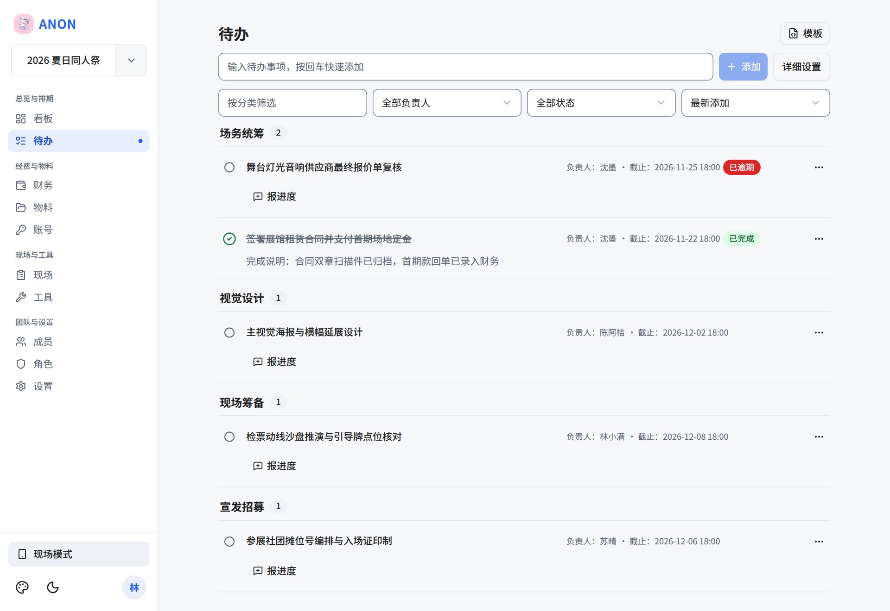
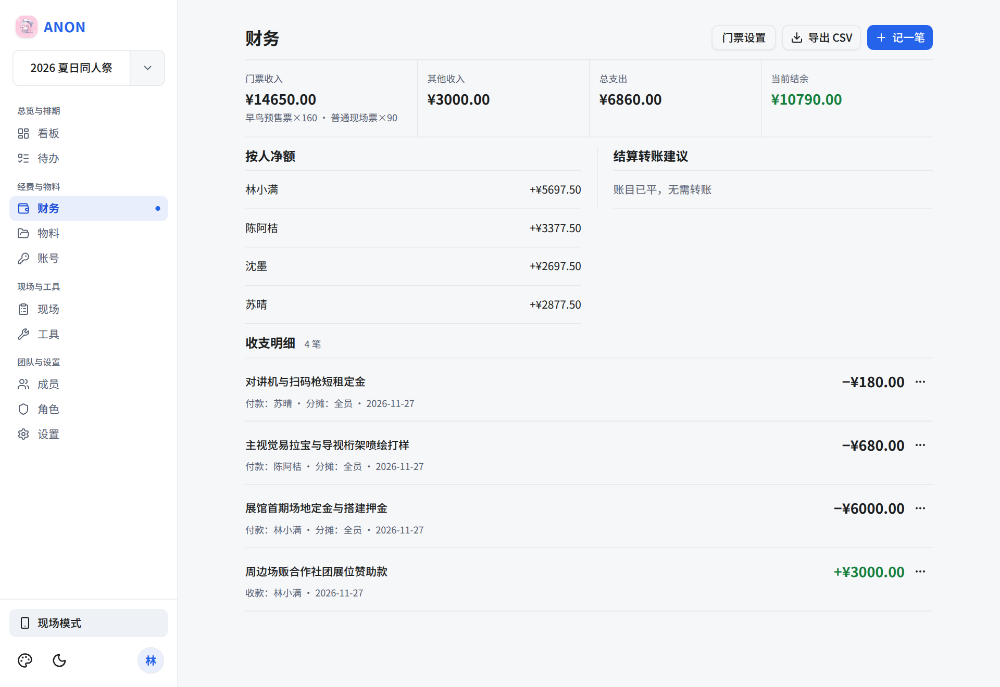
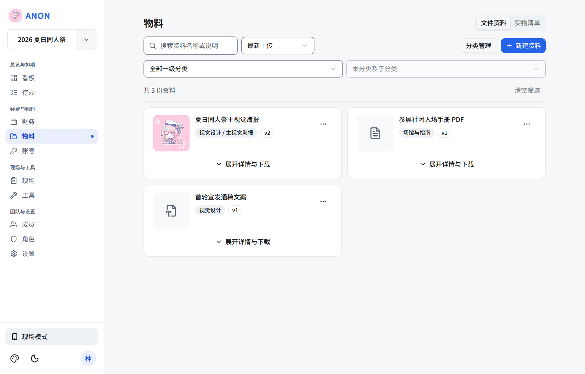
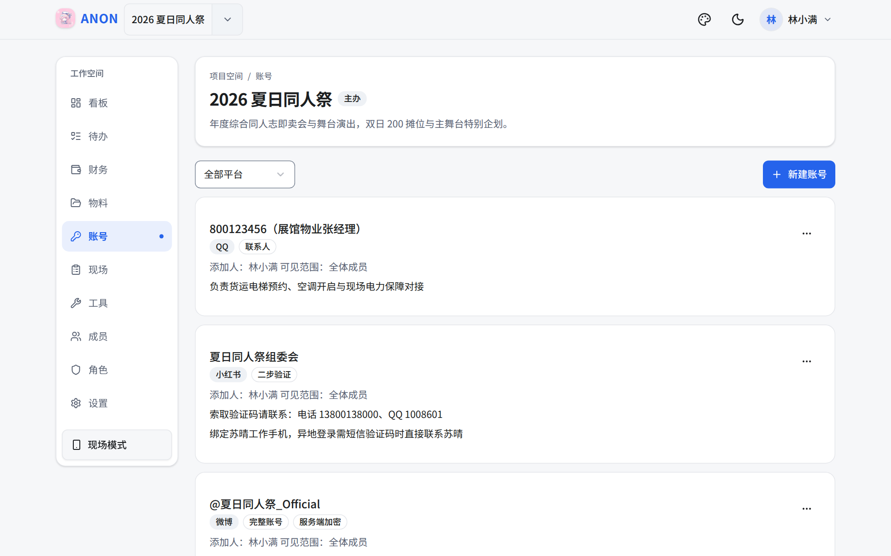
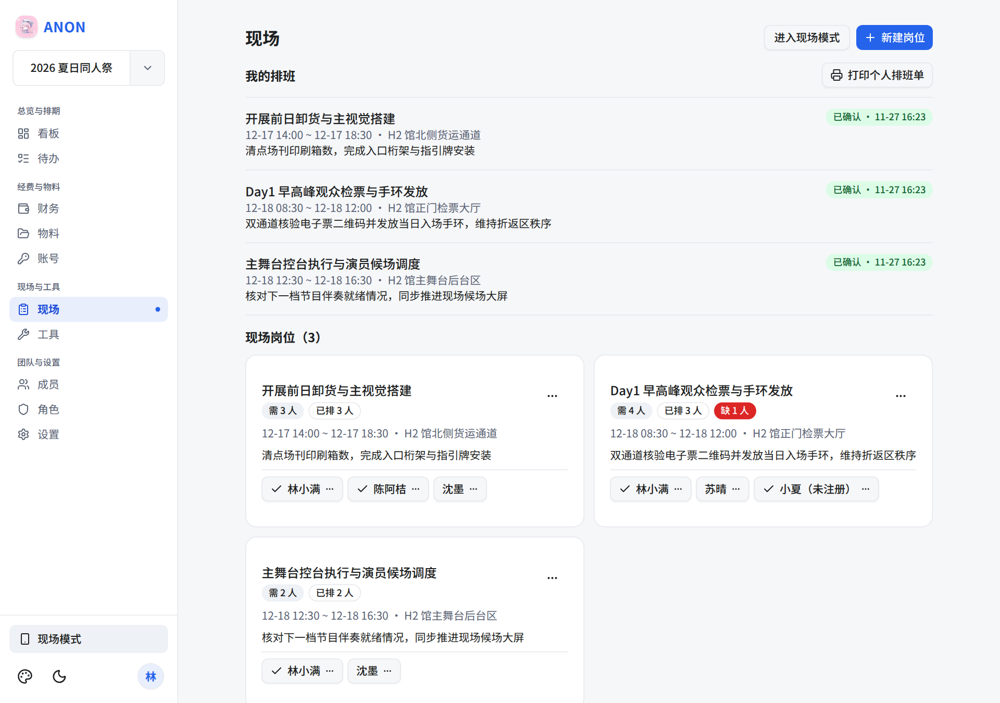
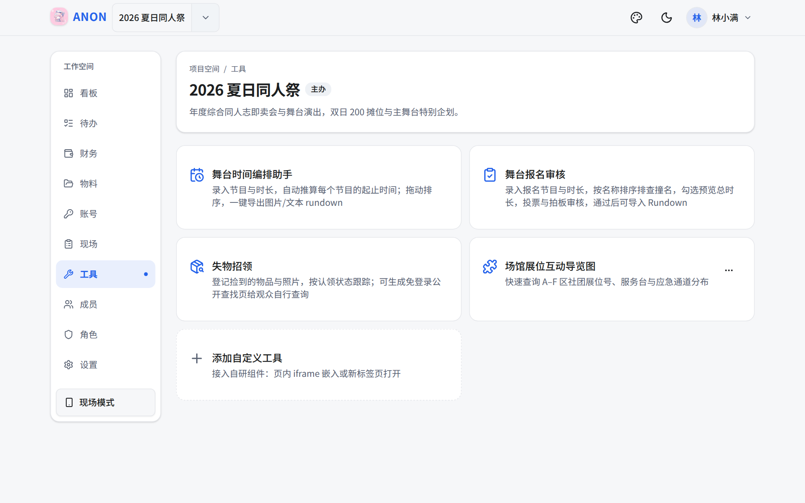
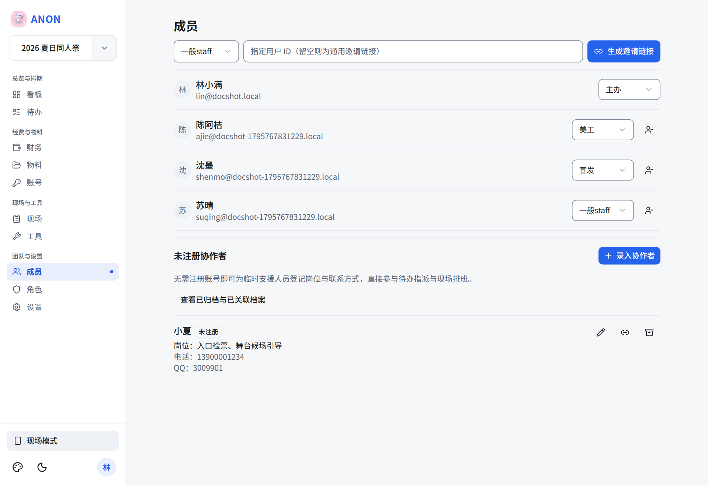

# ANON

[](LICENSE)

面向展会、同人志即卖会、舞台演出、校园祭等线下活动组织团队的**全流程协作与现场执行系统**。

> **Activities, Neatly Organized & Noted** ——「活动，被井然地组织与记录」。名称亦呼应 *anonymous*：团队平台账号密码默认在浏览器端完成 PBKDF2 + AES-GCM 加密，服务端零明文落库。

---

## 核心亮点

- **全周期一处收口**：以「项目」为单位串联筹备期（看板、待办排期、经费记账、设计稿版本、社媒账号）与执行期（岗位排班、离线现场模式、舞台实时控台、免登录候场大屏、失物招领公开页）。
- **不强制临时人员注册**：核心成员凭角色权限协作；当天帮忙的志愿者或外部协作者**仅需填姓名即可建档**，照常指派任务、排班与打印任务单，日后入项一键关联账号接续历史。
- **精细权限与零明文凭证**：15 项细分权限点动态裁剪可见界面；物料、账号、公告支持**高于角色权限的「可见范围」白名单**；平台密码默认浏览器端加密。
- **弱网现场可依赖**：移动端优先 PWA，支持添加到手机主屏；开展当日「现场模式」采用极简大字号触控设计，断网操作暂存本机队列，恢复信号自动补传。
- **三渠道通知与 QQ 机器人交互**：统一管线驱动邮件、Web Push 与 QQ 机器人（单聊全量 + 多群精选）；支持在 QQ 群或私聊一句话 AI 建待办、AI 文字记账、提交舞台节目报名、分段上传物料及导出讨论纪要。
- **零外部依赖一键自托管**：生产 Docker 编排内嵌 FerretDB（PostgreSQL 存储）与 MinIO 对象存储，一条命令即可在自有服务器拉起完整整栈，亦支持平滑切换外接 MongoDB 与云端 S3。

---

## 功能与界面预览

### 1. 项目工作台与总览看板

外层项目工作台汇总参与项目、进行中活动与活跃风险，支持多维检索。进入项目默认打开**看板**，一屏聚合开展倒计时、8 阶段步进器、关键里程碑、个人/项目双视角指标、待我处理快捷操作与团队分级公告（支持「我已知悉」确认回执名单）。系统自动探测 8 类筹备风险（逾期、缺人、超支、空壳物料等），支持管理者带原因与期限忽略闭环。



### 2. 待办排期与进度时间线

支持顶部回车极速建单与完整排期表单；已设开展日期的项目可开启**「开展倒排」**（按「开展前 N 天 + 时刻」录入并自动换算为日历日期）；支持正式成员与未注册临时档案混合指派。长周期任务可多次提交阶段进度与过程附件形成时间线；筹备清单可导出为相对偏移模板，供下一届活动锚定新日期一键批量生成。



### 3. 财务收支、改额与最简结算

支持多票种票房核算与日常收支垫付记账（可传多张发票/截图凭证，区分全员公款均摊与指定成员专项分摊）。账目金额变动时可直接**修改金额**（保留原凭证与分摊关系，实时重算全局数据）。系统精确到分计算每位成员应收/应付净额并给出**笔数最少的最简转账方案**，支持按成员导出 Excel 兼容的 UTF-8 BOM CSV 对账单。



### 4. 数字物料库与实物物资台账

- **数字资源**：最多两级类别结构与联动筛选，单文件支持最大 **1GB**（超 8MB 自动按 8MB 分片串行上传并显示实时进度）；多版本迭代切换时缩略图、全屏预览与下载同步跟随；原生支持位图（自动生成轻量 WebP 缩略图、点击按屏幕等比缩放原图）、**PDF、Markdown 与常见音视频**在线安全预览。
- **实物清单**：顶部分段开关一键切换实体物资台账，按分类追踪印刷品、设备、耗材的**计划 / 在库 / 使用 / 损耗**四维数量、备齐进度条与权限化变动审计日志。



### 5. 平台账号保险库

针对团队共用社媒账号、个人手机绑定的二步验证账号及外部合作方名录，分别提供**完整账号 / 二步验证辅助 / 联系人**三种模式。密码默认在浏览器本地经 `PBKDF2（60 万次 SHA-256）+ AES-GCM` 加密后上传，亦可选服务端密钥加密方便团队免口令共享。



### 6. 现场排班、A4 任务单与离线现场模式

展前按时段、地点与所需人力建立岗位任务模块，缺人自动预警；支持本人确认与管理员**代确认 / 代签到 / 代完成**；一键生成带签字栏的个人或全员分页连排 A4 任务单（浏览器直接打印或另存 PDF）。开展当天切入**「现场模式」**，一屏完成签到打卡、六分类异常上报、舞台控台推进、失物拍照快录与紧急电话直拨。



### 7. 舞台编排、报名审核、失物招领与自定义工具

- **舞台报名审核**：按批次设定舞台可用容量收集节目，自动高亮同名**「撞名」**节目，勾选实时试算总时长盈亏，成员投票评议后侧滑拍板，已通过节目一键追加导入正式流程单。
- **舞台时间编排（Rundown）与现场大屏**：拖拽或键盘调序自动推算全场起止时刻，支持自由勾选列导出长文本自动换行的 2 倍高清 PNG 与纯文本；演出当日开启**「执行模式」**实时双向级联推算后续预计时间，并可生成**免登录深色「现场大屏」**（`/screen/:token`）投屏至候场区（10 秒自动刷新、全员紧急公告上屏、自动隐去演员隐私信息）。
- **失物招领**：默认全角色可拍照登记遗失物并流转认领状态；一键开启**免登录对外公开查找页**（`/lf/:token`），张贴服务台二维码供观众自助检索。
- **自定义外部工具与 OpenAPI**：支持将团队自研独立 Web 组件以页内沙箱 iframe 或新窗口接入，经 `postMessage`（移动端独立窗口自动切换一次性 URL fragment）安全握手兑换按最小权限实时求交的 30 天 `anonk_` API 密钥；个人资料页亦支持自助生成 30 天或永久密钥供自动化脚本调用。



### 8. 成员管理、角色矩阵与 QQ 机器人协作

- **成员与角色**：一次性角色邀请链接、预置与自定义角色矩阵、未注册临时协作者建档与入项关联。
- **通知与 QQ 机器人**：配置 QQ 开放平台官方 Bot Webhook 后，成员私聊绑定收个人通知，项目可绑定多个工作群并逐群勾选 7 类精选通知；支持群内 `@机器人` 或私聊**一句话 AI 创建待办、AI 文字记账、提交舞台报名（支持逐群开关全员免绑报名授权）、免 AI 分段上传物料、合并转发或收集模式导出聊天记录为 Markdown**，发送 `帮助` 或 `/help` 随时查看指令菜单。



---

## 快速开始

### 方式一：Docker 一键整栈部署（推荐）

无需在宿主机安装 Node.js 或数据库，一条命令拉起完整生产环境（内嵌 FerretDB + PostgreSQL、内嵌 MinIO 对象存储、后端 API 与前端 Nginx，仅暴露单一端口）：

```bash
echo "JWT_SECRET=$(openssl rand -hex 32)" > .env   # 必填（≥32 字符），更多可选配置见 docs/readme.md
docker compose -f docker-compose.prod.yml up -d --build
# 浏览器访问 http://localhost:8080（在 .env 设置 WEB_PORT 可改端口）
```

### 方式二：本地源码开发

环境要求：Node.js 20+ 与 MongoDB（可直接用仓库自带开发编排起 `mongo:7`）。

```bash
docker compose up -d                                  # 启动开发用 MongoDB (:27017)
cp backend/.env.example backend/.env                  # 按需填写 JWT_SECRET 与 SUPER_ADMIN_EMAIL
cd backend && npm install && npm run dev              # 启动后端 API (:4000)
cd frontend && npm install && npm run dev             # 另开终端启动前端 (:5173，自动代理 /api)
```

浏览器打开 `http://localhost:5173`：使用 `SUPER_ADMIN_EMAIL` 注册首个账号（免邀请码自动成为超管）→ 进入顶部「管理」页生成邀请码 → 团队成员凭邀请码注册。

### 方式三：免注册快速体验

- **试用沙箱**：默认开启 `TRIAL_EMAIL=admin@test.com`，在登录页输入该邮箱与任意 ≥8 位密码即可进入带完整示例数据的独立环境（24 小时自动级联清理）。
- **纯前端演示站**：执行 `cd frontend && npm run build:demo` 即可产出零后端依赖的静态演示包（浏览器内拦截 `/api` 模拟全部业务契约，可直接托管至 Cloudflare Pages 等静态平台）。

---

## 架构与技术栈

```text
浏览器 / 手机 PWA
  └─▶ [可选] Cloudflare Worker 边缘层（静态资产托管 + /api 反代 + QQ Webhook 边缘验签应答）
        └─▶ Nginx 非特权容器（SPA 路由回退 + 安全响应头 + 1025MB 大文件上传反代）
              └─▶ Express 4 + TypeScript 后端（JWT 双令牌轮换 / anonk_ 密钥收窄 / RBAC + 可见范围）
                    ├─▶ MongoDB 协议存储（默认内嵌 FerretDB v2 + PostgreSQL，可切换外接 MongoDB）
                    └─▶ 文件与缩略图存储（默认内嵌 MinIO S3，可切换外部 S3 或本地磁盘）
```

| 层级 | 核心技术选型 |
| --- | --- |
| **后端 (`backend/`)** | Express 4 · TypeScript · Mongoose 8 · JWT (15m access + 30d 轮换 refresh) · Multer 2.5 · Sharp (WebP 缩略图) · Nodemailer / Web-Push / TweetNaCl · Vitest 4 + Supertest |
| **前端 (`frontend/`)** | Vite 6 · React 18 · TypeScript · Tailwind CSS v4 · shadcn/ui (Radix) · dnd-kit · driver.js · vite-plugin-pwa (Workbox + Web Push) |
| **边缘 (`worker/`)** | Cloudflare Workers (Static Assets + 源站反代 + QQ Bot Ed25519 边缘验签) |

---

## 文档地图

| 文档 | 内容说明 |
| --- | --- |
| [docs/tutorial.md](docs/tutorial.md) | **全流程实战教程**：按一场线下活动从立项到复盘的时间线手把手演示各模块配合 |
| [docs/readme.md](docs/readme.md) | **部署与运维指南**：Docker 编排、环境变量全表、Cron 定时任务、Workers 边缘部署与安全基线 |
| [docs/features.md](docs/features.md) | **功能参考手册**：按模块详述全部业务规则、交互细节与权限矩阵 |
| [docs/api.md](docs/api.md) | **HTTP 接口契约**：全部端点的请求/响应结构、状态码与权限要求（人类可读版） |
| [docs/openapi.yaml](docs/openapi.yaml) | **OpenAPI 3.0 规范**：181 个接口操作的机器可读规范（支持脚本双向覆盖率校验） |
| [docs/plugin-development.md](docs/plugin-development.md) | **自定义工具开发指南**：外部 Web 组件接入、启动令牌握手协议与 OpenAPI 密钥调用示例 |
| [docs/demo-site.md](docs/demo-site.md) | **纯前端演示站说明**：`build:demo` 构建原理、内存/IndexedDB Mock 内核与会话保留机制 |
| [docs/design.md](docs/design.md) / [docs/progress.md](docs/progress.md) | 架构演进记录与阶段迭代日志 |
| [docs/file-index.md](docs/file-index.md) | 全库「文件 → 功能模块」速查索引 |

---

## 开发与贡献

欢迎提交 Issue 与 Pull Request。合入代码前请确保通过以下质量门：

```bash
cd backend && npm test && npm run typecheck                  # 后端集成测试与类型检查
cd backend && npx tsx scripts/check-openapi-coverage.ts      # 接口变更时校验 OpenAPI 覆盖率
cd frontend && npm run check:session && npm run build        # 前端会话安全回归与生产构建
```

- 提交信息遵循 Conventional Commits 规范（`feat:` / `fix:` / `docs:` / `chore:`）。
- 新增 shadcn 组件请使用 `npx shadcn@3`（兼容当前 `components.json` 配置）。
- 依赖锁文件变更会自动触发 GitHub Actions `osv-scanner` 漏洞扫描（见 `.github/workflows/dependency-scan.yml`）。

### 构建依赖安全约束说明

前端仅导入 shadcn 样式资产，当前 `frontend/package.json` 保留三项构建期传递依赖的临时 `overrides` 以确保零已知漏洞：

- `deepmerge` 固定为未受 `GHSA-gcqx-w48m-w2h4` 影响的 `4.1.1`（上游 `4.2.0–4.3.1` 尚无补丁版）。
- `@ts-morph/common` 下的 `minimatch` 指定 `^11.0.1`（修复 `GHSA-g3hv-75wg-m249`）。
- `workbox-build` 下的 `glob` 指定 `^14.0.2`（修复 `GHSA-3g3m-2fjr-6pw4`）。

待上游发布安全版本后可移除对应覆盖，并重新执行 `npm ci`、双模式构建与 OSV 扫描验证。

---

## 许可证

[MIT](LICENSE) © 2026 ShiratsuyuClassYuudachi
