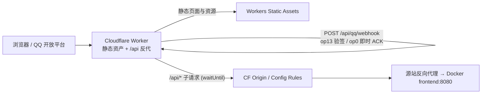

# ANON 部署、配置与运维指南

本文档面向自托管管理员与开发者，完整说明 ANON 的本地开发环境、Docker 生产整栈部署、环境变量参考、Cron 定时提醒、Cloudflare Workers 边缘接入及安全加固规范。

- 面向活动团队的使用教程见 [`docs/tutorial.md`](./tutorial.md)，模块功能详述见 [`docs/features.md`](./features.md)
- HTTP 接口契约见 [`docs/api.md`](./api.md) 与 [`docs/openapi.yaml`](./openapi.yaml)
- 外部自定义工具对接见 [`docs/plugin-development.md`](./plugin-development.md)

---

## 1. 运行与部署形态一览

| 形态 | 适用场景 | 核心组成 |
| --- | --- | --- |
| **Docker 生产整栈（推荐）** | 团队正式自托管、内网或云服务器部署 | `docker-compose.prod.yml`：Nginx 前端 + Express 后端 + 内嵌 FerretDB(PostgreSQL) + 内嵌 MinIO，单端口对外 |
| **Cloudflare Workers 边缘接入** | 源站位于非标端口/家庭宽带，需全球边缘静态加速与统一 443 入口 | `worker/` 托管前端静态资产，`/api/*` 反代回源站，边缘直接完成 QQ Webhook 验签与即时 ACK |
| **本地源码开发** | 二次开发、接口联调与自动化测试 | `docker-compose.yml` 起 `mongo:7`，前后端分别 `npm run dev` 热重载 |
| **纯前端演示站** | 公开功能展示，零服务器运维成本 | `frontend` 执行 `npm run build:demo` 托管至 Cloudflare Pages，浏览器内存 + IndexedDB 模拟全套后端契约（详见 [`docs/demo-site.md`](./demo-site.md)） |

---

## 2. 本地开发环境启动

### 环境要求

- **Node.js**：`20+`（推荐 Node.js 22 LTS）
- **MongoDB**：可使用仓库自带 `docker compose up -d` 启动 `mongo:7`，或连接任意已有 MongoDB 实例。后端集成测试基于 `mongodb-memory-server` 内存库运行，无需预装数据库或 Docker。

### 启动步骤

```bash
# 1. 启动本地开发 MongoDB（若使用外部 MongoDB 可跳过）
docker compose up -d

# 2. 初始化后端环境变量（按需设置 JWT_SECRET 与 SUPER_ADMIN_EMAIL）
cp backend/.env.example backend/.env

# 3. 安装依赖并启动后端开发服务（默认监听 :4000）
cd backend && npm install && npm run dev

# 4. 另开终端启动前端开发服务（默认监听 :5173，自动将 /api 代理至 :4000）
cd frontend && npm install && npm run dev
```

- **初始化超管与邀请码**：浏览器打开 `http://localhost:5173/register`，在空库状态下使用 `SUPER_ADMIN_EMAIL` 所配邮箱注册（免填邀请码），首个账号自动成为超级管理员；随后在顶栏「管理」页生成一次性邀请码供团队成员注册。
- **局域网移动设备联调**：执行 `cd frontend && npm run dev -- --host 0.0.0.0`，手机访问 `http://<开发机局域网IP>:5173` 即可真机调试（API 请求经 Vite 代理转发，无需额外暴露 4000 端口）。

---

## 3. Docker 生产整栈部署（推荐）

仓库内置多阶段构建 `Dockerfile` 与生产编排 `docker-compose.prod.yml`，无需宿主机具备 Node 环境即可一键运行。

### 一键启动

```bash
# 1. 在仓库根目录创建 .env（已 gitignore），生成不少于 32 字符的 JWT_SECRET
echo "JWT_SECRET=$(openssl rand -hex 32)" > .env
# 可按需在 .env 追加 SUPER_ADMIN_EMAIL、WEB_PORT、SMTP_*、VAPID_*、QQ_BOT_* 等配置

# 2. 构建前后端镜像并后台拉起全部服务
docker compose -f docker-compose.prod.yml up -d --build

# 3. 访问 http://localhost:8080（若在 .env 设置了 WEB_PORT=8081 则访问对应端口）
```

### 编排服务拓扑与存储切换

生产编排项目名固定为 `anon-prod`（与开发用 `docker-compose.yml` 互不干扰），仅 `frontend` 暴露唯一对外端口：

| 服务名 | 角色与网络边界 | 持久化卷 / 外部切换方式 |
| --- | --- | --- |
| `frontend` | 非特权 Nginx（容器内 `:8080`），托管静态资源、SPA 回退、下发安全头，将 `/api/` 反代至 `backend:4000`（请求体上限 `1025m`，支持 1GB 物料上传） | 宿主机端口由 `${WEB_PORT:-8080}` 控制 |
| `backend` | 非 root Node 22 运行时（仅编排内网 `:4000` 可达） | 本地文件回退卷 `uploads-data` |
| `ferretdb` + `postgres` | **默认内嵌数据库**：FerretDB v2 提供 MongoDB 协议，PostgreSQL 17（DocumentDB 扩展）落盘，不暴露宿主机端口 | 数据卷 `pg-data`；在根 `.env` 设置 `MONGO_URI` 即优先连接外接 MongoDB，此时可注释或不启动这两个服务 |
| `minio` | **默认内嵌对象存储**：S3 兼容 API（编排内 `:9000`），上传文件与 WebP 预览图默认存入此处（桶不存在自动创建） | 数据卷 `minio-data`；根 `.env` 覆盖 `S3_*` 可改连阿里云 OSS / AWS S3 / R2；设 `S3_ENDPOINT=` 为空则回退本地磁盘 `uploads-data`（历史本地文件与 S3 对象支持混合读取） |

### 常用运维命令

```bash
# 查看后端实时日志
docker compose -f docker-compose.prod.yml logs -f backend

# 代码更新后仅重建并平滑重启前后端（保留数据库与对象存储容器）
docker compose -f docker-compose.prod.yml up -d --build backend frontend

# 停止服务（保留数据卷）
docker compose -f docker-compose.prod.yml down

# 单独构建镜像（用于自定义容器平台分发）
docker build -t anon-backend ./backend
docker build -t anon-frontend ./frontend
```

> **历史部署升级提示**：早期以 `root` 初始化过 `uploads-data` 卷的旧实例升级到非 root 后端容器（UID `1000`）时，若采用本地磁盘存储，需执行一次卷属主迁移以防写入报 `EACCES`（全新部署无需执行）：
> ```bash
> docker compose -f docker-compose.prod.yml stop backend
> docker run --rm -v anon-prod_uploads-data:/data alpine chown -R 1000:1000 /data
> docker compose -f docker-compose.prod.yml up -d backend
> ```

---

## 4. 环境变量参考

本地开发配置于 `backend/.env`（模板见 `backend/.env.example`）；Docker 生产编排配置于仓库根目录 `.env`。

### 核心与数据库

| 变量 | 必填 | 默认值 | 说明 |
| --- | --- | --- | --- |
| `JWT_SECRET` | **生产必填** | 开发内置弱密钥 | JWT 签名密钥。生产环境（`NODE_ENV=production`）未配置或长度 `< 32` 字符将直接拒绝启动 |
| `MONGO_URI` | 否 | `mongodb://localhost:27017/anon`（Docker 编排默认连内嵌 `ferretdb`） | MongoDB 连接串 |
| `DB_USER` / `DB_PASSWORD` | 否（仅 Docker） | `anon` / `anon-dev-password` | Docker 编排内嵌 PostgreSQL / FerretDB 凭据，**公网部署务必修改** |
| `PORT` | 否 | `4000` | 后端监听端口 |
| `WEB_PORT` | 否（仅 Docker） | `8080` | Docker 编排 `frontend` 映射到宿主机的对外端口 |
| `SUPER_ADMIN_EMAIL` | 否 | 空 | 首超管引导邮箱：当数据库尚无任何用户时，用该邮箱注册免邀请码并自动获得超级管理员权限 |
| `TRIAL_EMAIL` | 否 | `admin@test.com` | 试用沙箱入口邮箱（加任意 ≥8 位密码即建 24h 独立演示环境）；置空（`TRIAL_EMAIL=`）可完全关闭试用模式 |
| `PLATFORM_CRYPTO_KEY` | 否 | 回退 `JWT_SECRET` | 平台账号「服务端密钥加密」模式的派生源（SHA-256 → AES-256-GCM）；默认的浏览器端加密不依赖此项 |

### 文件与对象存储

| 变量 | 必填 | 默认值 | 说明 |
| --- | --- | --- | --- |
| `UPLOAD_DIR` | 否 | `uploads` | 未配置 S3 时的本地文件存储目录（已 gitignore） |
| `S3_ENDPOINT` | 否 | 空（Docker 编排默认 `http://minio:9000`） | S3 兼容服务地址；非空时启用 S3 存储，置空回退本地磁盘 |
| `S3_BUCKET` / `S3_REGION` | 否 | `anon-files` / `us-east-1` | 对象存储桶名称（不存在时自动创建）与区域标识 |
| `S3_ACCESS_KEY` / `S3_SECRET_KEY` | 启用 S3 必填 | Docker 默认 `anon-minio` / `anon-minio-password` | 对象存储访问凭据，**公网部署务必替换默认口令** |

### 定时任务、邮件与 Web Push

| 变量 | 必填 | 默认值 | 说明 |
| --- | --- | --- | --- |
| `CRON_SECRET` | 定时提醒必填 | 空 | `/api/cron/*` 接口的 Bearer 鉴权密钥（常数时间比对）；未配置时接口返回 `503 cron_disabled` |
| `SMTP_HOST` / `SMTP_PORT` / `SMTP_USER` / `SMTP_PASS` / `SMTP_FROM` | 否 | `SMTP_PORT=587`，其余空 | SMTP 邮件通知配置；未配置 `SMTP_HOST` 时邮件降级为服务端控制台日志，不阻塞业务 |
| `VAPID_PUBLIC_KEY` / `VAPID_PRIVATE_KEY` / `VAPID_SUBJECT` | 否 | 空 | Web Push 浏览器推送密钥（可通过 `npx web-push generate-vapid-keys` 生成）；未配置时前端自动隐藏推送开关 |

### QQ 机器人通知与 AI 智能解析

| 变量 | 必填 | 默认值 | 说明 |
| --- | --- | --- | --- |
| `QQ_BOT_APP_ID` / `QQ_BOT_APP_SECRET` | 否 | 空 | QQ 开放平台官方 Bot API v2 凭据；未配置时 QQ 渠道静默禁用 |
| `QQ_BOT_SANDBOX` | 否 | 空 | 设为 `true` 时调用 QQ 沙箱 API 域名（沙箱需在管理端配置群白名单） |
| `PUBLIC_BASE_URL` | 否 | 空 | 站点对外访问根地址（如 `https://app.example.com`），用于拼接 QQ 通知末尾直达链接与聊天记录导出 `/dl/:id` 下载地址 |
| `AI_API_KEY` | 否 | 空 | OpenAI 兼容接口密钥，驱动 QQ 待办创建、舞台报名提取与文字记账解析；未配置时仅 AI 解析静默关闭，绑定通知、分段物料上传、聊天导出与 `帮助` 菜单仍照常可用 |
| `AI_BASE_URL` / `AI_MODEL` | 否 | `https://api.deepseek.com` / `deepseek-v4-flash` | AI 模型接口基座与模型名 |
| `QQ_DEBUG_EVENTS` | 否 | 空 | 设为 `1` 时打印 QQ 富媒体/转发事件原始载荷，仅供联调排障使用 |

> **QQ 开放平台配置要点**：在机器人管理端将回调地址设为 `https://<公开域名>/api/qq/webhook`（平台仅支持 443/8443/80/8080 端口），订阅「单聊消息」及「群聊@消息」（或「群消息全量」，服务端自动按 `@机器人` 过滤并对同一消息去重）；若需发送群定时提醒，需在管理端单独开启「群聊主动消息」权限。进程内录入草稿（报名/记账 10 分钟、物料/导出收集 30 分钟）在容器重启后需重新发起。

---

## 5. 定时任务配置（Cron 提醒与周报）

后端提供两个幂等去重的定时扫描端点（Docker 部署下可直接经前端端口访问，本地裸跑则访问 `:4000`）：

```bash
# 1. 待办节点/到期提醒 + 里程碑临近（提前 3 天）扫描 —— 建议每分钟执行一次
curl -fsS -X POST -H "Authorization: Bearer $CRON_SECRET" \
  http://127.0.0.1:8080/api/cron/reminders

# 2. 活跃项目每周进度周报 —— 建议每周一上午执行一次
curl -fsS -X POST -H "Authorization: Bearer $CRON_SECRET" \
  http://127.0.0.1:8080/api/cron/weekly-report
```

- 两个端点均返回 `{"sent": <本次成功触发条数>}`。
- **投递重试保障**：仅当所有已启用渠道投递成功后才写入 `ReminderLog` / `WeeklyReportLog` 唯一去重记录；若遇临时网络故障，下一轮扫描会自动重试而不会漏发。

宿主机 `crontab -e` 参考示例：

```cron
* * * * * curl -fsS -X POST -H "Authorization: Bearer 你的CRON_SECRET" http://127.0.0.1:8080/api/cron/reminders >/dev/null
0 9 * * 1 curl -fsS -X POST -H "Authorization: Bearer 你的CRON_SECRET" http://127.0.0.1:8080/api/cron/weekly-report >/dev/null
```

---

## 6. Cloudflare Workers 边缘部署（可选公网加速）

当源站部署在家庭宽带或非标 HTTPS 端口时，可使用 `worker/` 目录将前端静态产物发布到 Cloudflare 全球边缘，并将 `/api/*` 安全反代回源站：



### 发布流程

```bash
cd frontend && npm run build                     # 1. 生成最新前端生产构建产物
cd ../worker && npm install                      # 2. 首次安装 wrangler 与边缘验签依赖
CLOUDFLARE_API_TOKEN=... CLOUDFLARE_ACCOUNT_ID=... npm run deploy
```

### 边缘运维关键事项

1. **自动清理 `_redirects`**：`worker/package.json` 的 `deploy` 脚本会将 `frontend/dist` 拷贝至 `.deploy-assets/` 并剔除 Pages 专用的 `_redirects` 文件，避免触发 Workers Assets 的 `100324` 路由校验冲突。
2. **真实客户端 IP 透传**：Worker 反代 `/api/*` 时显式注入 `X-Forwarded-For: <cf-connecting-ip>`，配合后端 `trust proxy 1` 确保登录限流按真实访客 IP 计数。
3. **QQ Webhook 边缘即时应答**：QQ 平台回调窗口仅约 3 秒，Worker 在边缘直接用 Ed25519 完成 `op=13` 地址校验签名与 `op=0` 事件即时 ACK（`{"opcode":12}`），随后通过 `ctx.waitUntil` 异步转发源站执行 AI 解析与落库。启用 QQ 渠道时需向 Worker 写入密钥（轮换时与源站 `.env` 同步更新）：
   ```bash
   cd worker && printf '%s' '<你的QQ_BOT_APP_SECRET>' | npx wrangler secret put QQ_BOT_APP_SECRET
   ```
4. **安全响应头双端同步**：`worker/src/index.js` 中的 `SECURITY_HEADERS` 与 `frontend/nginx.conf` 保持逐字一致——**修改任意一侧的 CSP 或安全头时必须同步更新另一侧**。
5. **同 Zone 非标端口回源方案**：若自定义域名与源站同属一个 Cloudflare Zone，修改 `worker/wrangler.toml` 的 `[vars].ORIGIN` 指向橙云子域（如 `https://origin.example.com`），并在 Cloudflare 配置 Origin Rule（改写目标端口）与 Configuration Rule（SSL 设为 Full）即可打通回源。

---

## 7. 安全设计基线与公网检查清单

### 公网上线必做三件事

1. **前置启用 HTTPS**：`frontend` 容器仅监听明文 HTTP，公网暴露必须在前置反向代理（Caddy / Nginx / Cloudflare）终止 TLS。
2. **替换全部默认口令**：务必在根目录 `.env` 中用强随机串覆盖 `DB_PASSWORD`、`S3_ACCESS_KEY` 与 `S3_SECRET_KEY`。
3. **配置高强度 `JWT_SECRET`**：使用 `openssl rand -hex 32` 生成不少于 32 字符的密钥。

### 内置安全机制摘要

- **双令牌滚动会话与前端换号隔离**：Access Token 15 分钟有效；Refresh Token 30 天滚动轮换（数据库仅存 SHA-256 哈希，单用户上限 10 个，登出即吊销）。前端内置会话标识校验与跨标签页 Web Locks 刷新互斥，切换账号时自动丢弃在途旧请求与上传回调。
- **分层速率限制与禁缓存**：`/api/auth/*` 限制 50 次/15 分钟/IP；免登录公开分享端点（失物招领、现场大屏）限制 300 次/分钟/IP；API 密钥兑换限制 60 次/15 分钟/IP。全量 API 响应强制下发 `Cache-Control: no-store` 与 `Vary: Authorization`，JSON 解析失败脱敏不记录原始请求体。
- **OpenAPI 密钥最小权限围栏**：`anonk_` 密钥仅存 SHA-256 哈希，原文创建时只回显一次；每次请求实时计算 `密钥 scopes ∩ 持有者当前角色权限`，且用户态敏感路由（`/api/me`、`/api/admin`、`/api/push`、`/api/invites`、`/api/files`、项目创建与全量列表）整体拒绝密钥调用（`403 api_key_forbidden`）。
- **文件内联预览白名单与严格 CSP**：仅位图生成 WebP 缩略图；内联预览严格限制在位图、PDF、Markdown（转义原始 HTML）与常见音视频，SVG 等潜在脚本载体一律拒绝预览并强制 `Content-Disposition: attachment` 下载；静态页下发无 `unsafe-inline` 脚本的严格 CSP 及 `frame-ancestors 'none'`。
- **非特权容器与持续漏洞扫描**：后端以 `node` 用户、前端以 `nginx-unprivileged` 运行；GitHub Actions 每周及锁文件变更时运行固定版本 `osv-scanner` 审计前后端依赖树。

---

## 8. 构建、测试与端到端冒烟

### 质量门命令

```bash
# 后端：全量集成测试（Vitest 串行内存库）+ TypeScript 类型检查 + 生产编译
cd backend && npm test && npm run typecheck && npm run build

# 接口契约：双向核对 Express 路由表与 docs/openapi.yaml 覆盖率
cd backend && npx tsx scripts/check-openapi-coverage.ts

# 前端：会话与上传换号隔离回归（15 项）+ 生产构建（含 PWA Service Worker 补丁）+ 演示构建
cd frontend && npm run check:session && npm run build && npm run build:demo
```

### 核心链路 curl 冒烟验证

在服务启动后（以本地 `:4000` 为例，已设 `SUPER_ADMIN_EMAIL=admin@example.com`），可用以下命令快速验证核心闭环：

```bash
# 1. 健康检查
curl -fsS http://localhost:4000/api/health
# -> {"ok":true}

# 2. 注册首个超级管理员
TOKEN=$(curl -fsS -X POST http://localhost:4000/api/auth/register \
  -H 'Content-Type: application/json' \
  -d '{"email":"admin@example.com","name":"Admin","password":"password123"}' | jq -r .token)

# 3. 创建邀请码与首个活动项目
curl -fsS -X POST http://localhost:4000/api/admin/invite-codes \
  -H "Authorization: Bearer $TOKEN" -H 'Content-Type: application/json' -d '{}'

PID=$(curl -fsS -X POST http://localhost:4000/api/projects \
  -H "Authorization: Bearer $TOKEN" -H 'Content-Type: application/json' \
  -d '{"name":"冒烟测试活动"}' | jq -r .project.id)

# 4. 创建一条待办并拉取看板聚合
curl -fsS -X POST "http://localhost:4000/api/projects/$PID/todos" \
  -H "Authorization: Bearer $TOKEN" -H 'Content-Type: application/json' \
  -d '{"title":"核对场地设备","category":"现场"}'

curl -fsS "http://localhost:4000/api/projects/$PID/dashboard" \
  -H "Authorization: Bearer $TOKEN" | jq .summary.metrics
```
