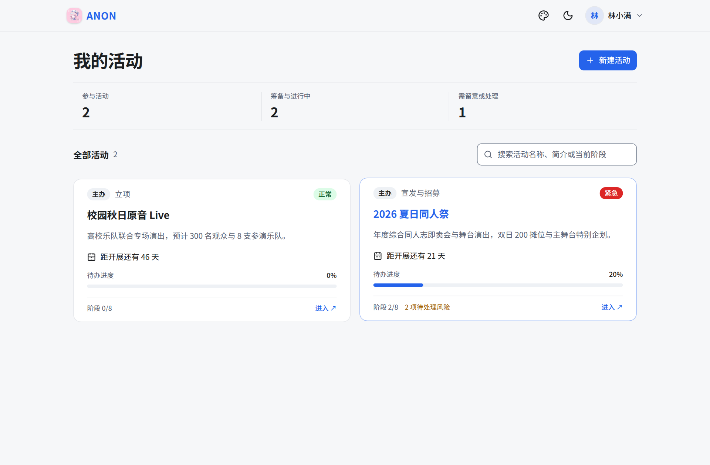
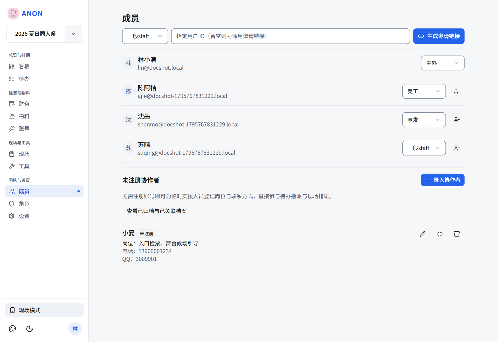
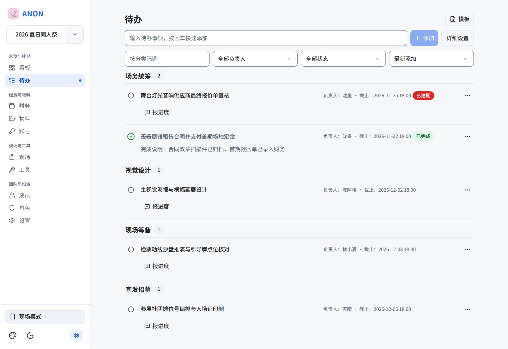
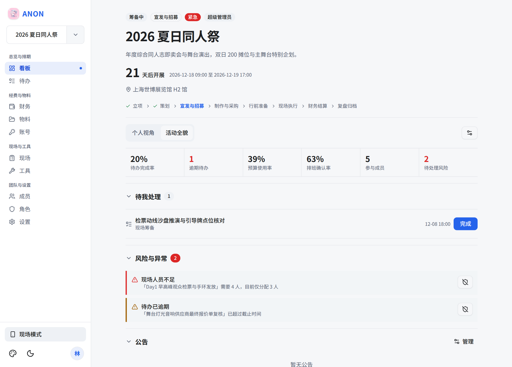
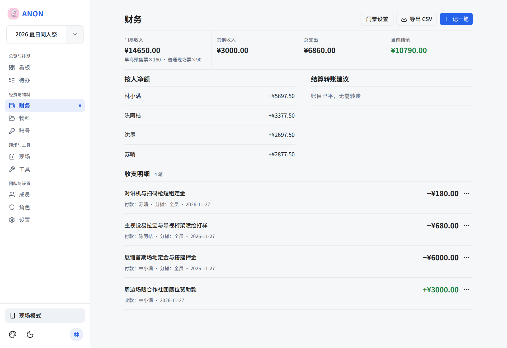
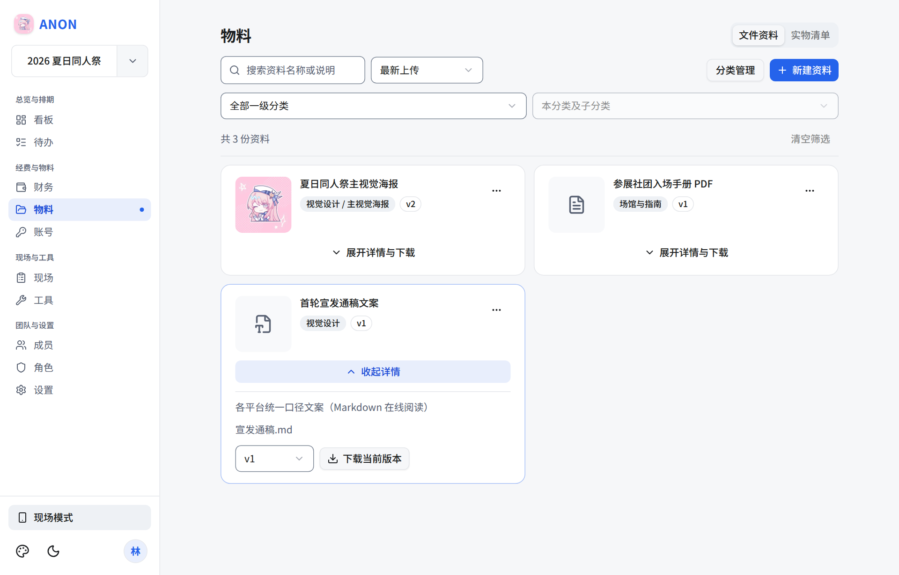
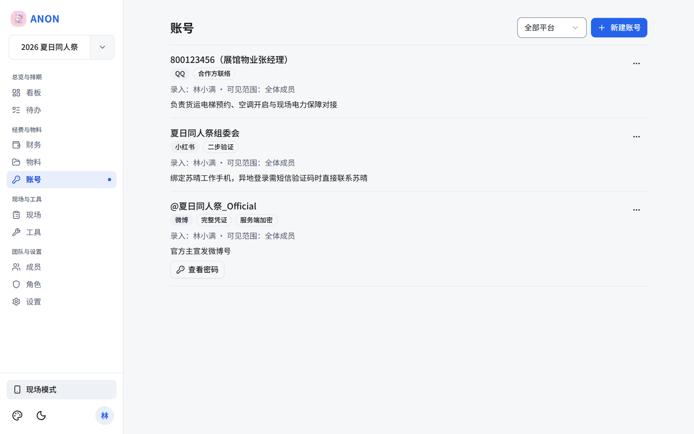
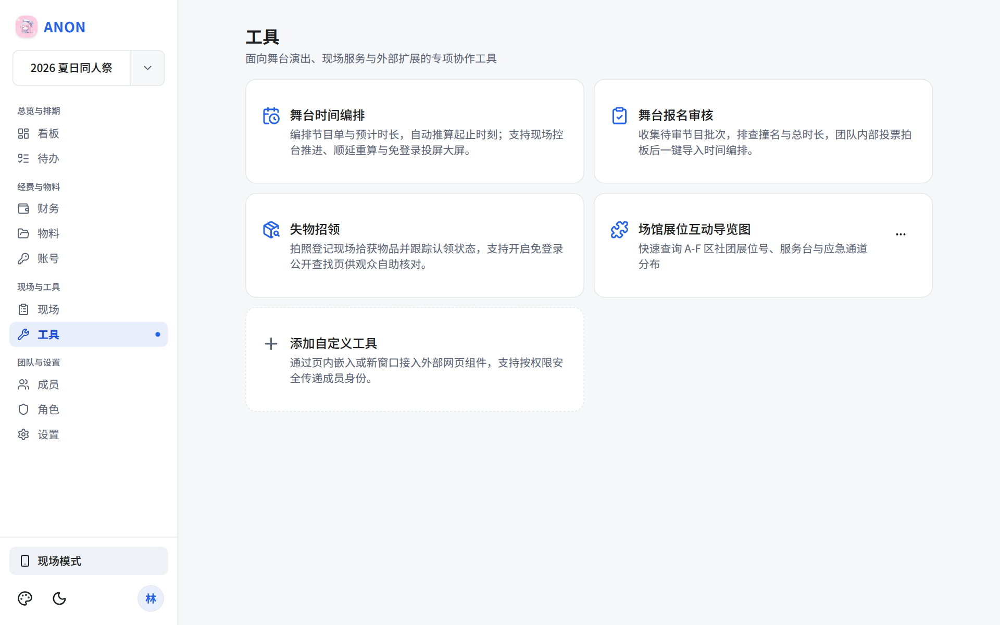
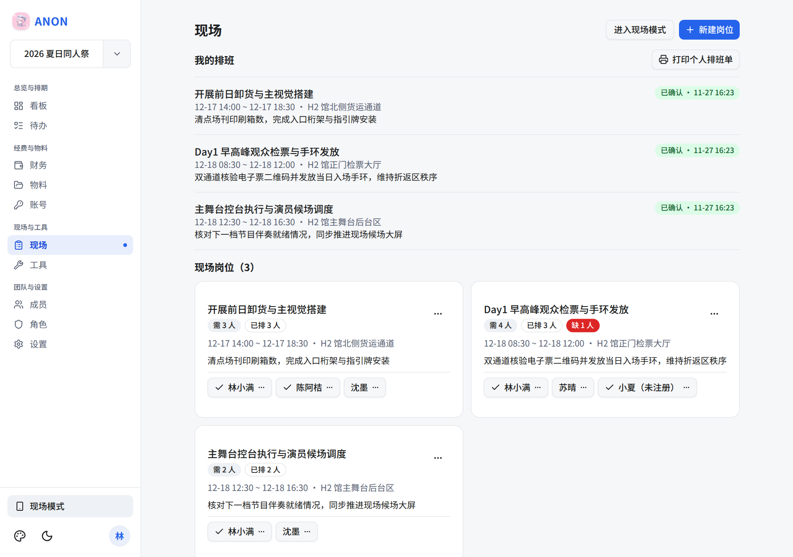
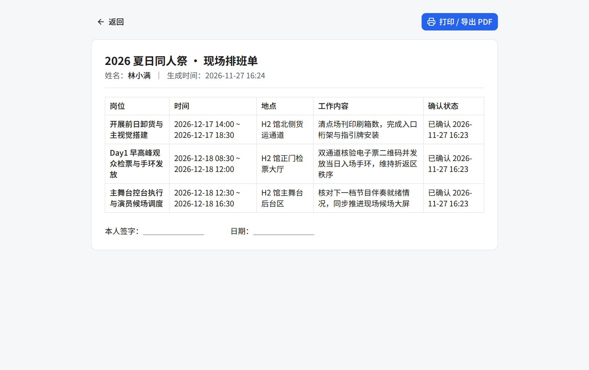

# ANON 使用教程：从零筹备到现场执行全流程指南

本教程按一场线下活动（以「夏日同人展 & 舞台演出」为例）的真实时间线，演示组织团队如何用 ANON 完成从立项组队、筹备排期、经费物料管理、舞台征集编排，到活动当天现场调度与展后结算复盘的完整闭环。

- 想按模块查阅某项功能的全部细节：见 [`docs/features.md`](./features.md)
- 想部署服务端、配置环境变量与定时任务：见 [`docs/readme.md`](./readme.md)
- 想对接接口或开发外部自定义组件：见 [`docs/api.md`](./api.md) 与 [`docs/plugin-development.md`](./plugin-development.md)

**目录**

1. [五分钟上手体验](#1-五分钟上手体验)
2. [第一阶段：立项、组队与权限分工](#2-第一阶段立项组队与权限分工)
3. [第二阶段：筹备期任务排期与进度追踪](#3-第二阶段筹备期任务排期与进度追踪)
4. [第三阶段：经费记账、物料版本与平台账号](#4-第三阶段经费记账物料版本与平台账号)
5. [第四阶段：舞台节目征集、审核与时间表编排](#5-第四阶段舞台节目征集审核与时间表编排)
6. [第五阶段：展前排班与多渠道通知（含 QQ 机器人）](#6-第五阶段展前排班与多渠道通知含-qq-机器人)
7. [第六阶段：活动当日——现场模式、舞台大屏与失物招领](#7-第六阶段活动当日现场模式舞台大屏与失物招领)
8. [第七阶段：展后收尾、对账结算与复盘](#8-第七阶段展后收尾对账结算与复盘)
9. [进阶篇：接入自定义工具与自动化脚本](#9-进阶篇接入自定义工具与自动化脚本)

---

## 1. 五分钟上手体验

在正式建组之前，你可以通过以下任一方式快速体验或启动系统：

### 方式 A：免部署试用模式（最快体验）

如果团队已有部署好的 ANON 实例（且未关闭 `TRIAL_EMAIL`）：

1. 打开登录页，邮箱填写 `admin@test.com`（默认试用邮箱），密码填写**任意不少于 8 位**的字符，点击登录。
2. 系统会立即为你生成一套隔离的演示环境（含示例活动、虚拟成员、待办、账目、物料、舞台节目单与失物招领数据）。
3. **密码即环境钥匙**：24 小时内使用同一密码再次登录，可回到同一套环境继续操作；满 24 小时后数据自动级联销毁。页面顶部会常驻琥珀色「试用」横幅提示销毁时间。

### 方式 B：纯前端演示站

如果使用 `cd frontend && npm run build:demo` 构建的纯前端演示站，打开页面即自动以演示管理员身份进入工作台，所有修改保存在当前浏览器标签页会话内，点击顶部横幅「还原示例数据」可随时重置。

### 方式 C：正式团队初始化

按 [`docs/readme.md`](./readme.md) 通过 Docker 一键拉起整栈后，只需 3 步完成团队冷启动：

1. **注册超级管理员**：在 `.env` 中设置 `SUPER_ADMIN_EMAIL=你的邮箱`。系统尚无用户时，打开注册页用该邮箱注册（邀请码留空），首个账号自动成为超级管理员。
2. **生成注册邀请码**：登录后点击顶栏进入「管理」页，输入自定义邀请码（至少 6 位）或留空自动生成，将邀请码发给核心成员。每个邀请码仅限使用一次。
3. **成员注册与填写联系方式**：成员凭邀请码注册登录后，建议先点右上角头像菜单 →「个人资料」，填写常用联系方式（如 QQ、微信、手机号）——后续现场排班拨号与平台账号索取验证码都会用到。

> 首次登录进入项目页时，系统会自动弹出 3 页欢迎幻灯，点击「开始导览」即可跟随高亮指引跨页面熟悉全部核心模块；之后随时可在右上角头像菜单点击「重看引导」或打开「帮助文档」（`/help`）。

---

## 2. 第一阶段：立项、组队与权限分工

### 2.1 创建活动项目与维护阶段

1. 在「我的活动」点击 **「+ 新建活动」**，填写活动名称（如「2026 夏日同人祭」）、开始与结束日期、活动简介，点击创建。创建者自动成为该活动的 **「主办」**（拥有活动内全部权限）。
2. 新建活动会自动生成 **8 个预设阶段**：
   > 立项 → 策划 → 宣发与招募 → 制作与采购 → 行前准备 → 现场执行 → 财务结算 → 复盘归档
3. 如需调整阶段或补充场地、时区信息，进入活动的 **「设置」** Tab：
   - 修改活动起止日期、举办地点与时区（默认 `Asia/Shanghai`）。
   - 在「阶段管理」区段增删自定义阶段、上下调整顺序、填写阶段备注，随筹备推进逐个点击「标记完成」，看板顶部的阶段进度条与活动列表卡片会同步推进。

### 2.2 配置角色与权限点

系统默认按权限裁剪界面——成员只会看到自己有权访问的 Tab 与操作按钮。

- **开箱即用的预置角色**：
  - **主办**：拥有全部权限。
  - **美工 / 宣发**：可上传文件、创建与完成待办、记录本人经手账目、管理失物招领。
  - **一般 staff**：可创建与完成待办、记录本人经手账目、管理失物招领。
- **自定义细分角色**：若团队设有「舞台组长」「总财务」「物料总管」等岗位，进入 **「角色」** Tab，输入角色名称并按需勾选权限点（如为舞台组长勾选 `tools:manage` 工具管理与 `work:manage` 现场分工管理，为总财务勾选 `finance:manage` 财务管理），保存即可。

### 2.3 邀请注册成员加入项目

1. 进入 **「成员」** Tab，选择要授予的角色（如「宣发」）。
2. 点击 **「生成链接」**（可选指定某位已注册用户的 ID；留空则为一次性开放链接，默认 72 小时有效）。
3. 将生成的链接发给伙伴，对方登录后打开链接点击「接受邀请」即刻入项。后续如需调岗，直接在成员卡片下拉框切换角色即可实时生效。

### 2.4 为临时协作者建立「未注册成员档案」

活动往往有许多当天帮忙的志愿者、临时兼职或外部支援人员，无需让他们逐一拿邀请码注册账号：

1. 在 **「成员」** Tab 上方的 **「未注册协作者」** 区段点击新建，**只需填写姓名**（岗位分工与电话/QQ 等联系方式可随时补填）即可建档。
2. 建档后，他们会像正式成员一样出现在 **待办负责人** 和 **现场岗位排班** 的候选列表中；管理者可代他们执行确认、签到、提交进度与完成任务（系统会记录实际代操作人），也能为他们单独或合并打印排班单。
3. 如果某位协作者后来注册并加入了活动，在档案菜单点击 **「关联账号」** 选定其账号，之前的岗位、联系方式、历史待办与现场签到状态会自动无缝合并到该账号名下。

---

## 3. 第二阶段：筹备期任务排期与进度追踪

### 3.1 快速建单与「开展倒排」日期

进入 **「待办」** Tab：

- **随手速记**：在顶部输入框敲入待办标题（如「联系饮用水供应商询价」）直接按回车，1 秒建好待办。
- **详细排期**：点击右侧 **「详细设置」** 打开完整表单，可设置负责人（支持同时勾选正式成员与未注册协作者档案）、到期时间，展开「更多字段」还可设置分类（如「宣传」「招商」「物料」）、节点时间、提醒时间与备注。
- **开展倒排录入**：只要活动已设置开始日期，到期/节点/提醒三个时间字段旁都会出现 **「开展倒排」** 开关。开启后直接输入「开展前 `14` 天 `18:00`」，下方会实时预览换算出的具体日历时间并保存为绝对日期，排倒计时计划时无需翻日历心算。

### 3.2 跟进进度时间线与完成闭环

- **阶段性汇报**：长周期任务（如「主视觉海报绘制」）未完成前，负责人可多次点击条目上的 **「报进度」** 按钮，提交文字进展并附上草图文件，下方会形成按时间倒序排列的进度时间线。
- **完成交单**：点击待办左侧圆圈按钮，填写完成说明并上传最终凭证附件，确认后任务划线归档。若需返工，管理者可在行尾 `⋯` 菜单点击 **「重新打开」**。

### 3.3 每日开工看「看板」：里程碑、公告与风险闭环

进入活动默认落在 **「看板」** Tab：

- **个人视角 vs 活动全貌**：普通成员默认看「个人视角」，聚焦「待我处理」（可直接一键完成待办、确认现场排班）和近期日程；统筹者切换到「活动全貌」，纵览待办完成率、预算使用率、排班确认率与各板块概览。
- **关键里程碑**：在「里程碑」区段登记硬性时间节点（如「宣传终稿截止」「场馆搭建方案提交」），到期前 3 天系统会自动提醒管理者。
- **团队公告**：在「公告」区段点击「管理」发布普通/重要/紧急公告，勾选 **「需要确认」** 后可随时查看「已确认 / 未确认」成员名单，确保关键变更传达到位。
- **自动风险检测**：系统会自动巡检待办逾期、待办无负责人、支出超总收入、现场人员不足、资料待传文件等 8 类风险。若某项风险已知可控，管理者可点击 **「忽略」** 填写原因并设忽略期限（1 天 / 至活动开始 / 永久），问题解决后风险自动解除。

### 3.4 系列活动模板复用

筹备成熟后，在「待办」Tab 右上角点击 **「模板 → 导出为模板」** 下载 JSON 文件（自动记录每条待办相对活动开始/结束日期的时间偏移）。下一届活动立项后，点击 **「模板 → 导入模板…」** 并填入新活动日期，全套筹备待办将按新排期自动重算时间批量生成。

---

## 4. 第三阶段：经费记账、物料版本与平台账号

### 4.1 经费收支、改金额与自动结算

进入 **「财务」** Tab：

1. **设置多票种**（财务管理者）：点击 **「门票设置」**，添加预售票、现场票等票种的单价与售出数量，票房收入自动计入项目公款池。
2. **日常记账**（全员可用）：垫付采购或收到赞助后，点击 **「记一笔」**，选择支出或收入、输入金额（元）、选定实际收付款人、上传付款截图凭证：
   - **全员公款账**：不勾选平摊人，表示计入项目公款池由全体成员均摊。
   - **专项小范围分摊**：勾选特定几位成员，则该笔费用仅在这些成员间均摊。
3. **修改账目金额**：若录入金额有误或尾款调整，在账目右上角 `⋯` 菜单点击 **「修改金额」**，输入新金额保存即可——原凭证截图、备注、付款人与分摊关系全部保留，项目盈亏汇总与建议转账方案实时重算。
4. **权限隔离**：普通成员（`finance:add`）只能查看和修改自己提交的账目；主办与财务管理者（`finance:manage`）可查看全盘汇总、每人应收应付净额与最简转账清单。

### 4.2 文件资料：两级分类、大文件上传与在线预览

进入 **「物料」** Tab（默认「文件资料」视图）：

1. **建立两级分类**：在「分类管理」中先建一级分类（如「视觉设计」「场馆与指南」），还可在分类下添加子分类（如 `视觉设计 → 主视觉海报`、`视觉设计 → 宣传文案`），并可随时调整层级或重命名。
2. **上传与大文件分片**：点击 **「+ 新建资料」**，可同时选择初始版本文件直接生成 `v1`。单文件支持最大 **1GB**（超过 8MB 自动按 8MB 分片串行上传并实时显示进度百分比，失败弹窗提示原因并保留表单供重试）。
3. **多版本对比与在线预览**：设计改稿后在卡片菜单点击 **「上传新版本」**（自动递增为 `v2`、`v3`…）。展开详情即可通过版本下拉框切换历史版本——缩略图、全屏大图预览与下载文件会同步切到所选版本。
   - 支持直接在线预览：**位图**（自动生成轻量 WebP 缩略图，点击按屏幕比例完整缩放原图）、**PDF 文档**、**Markdown 文稿**、**常见音视频**（mp4/webm/mov/mp3/wav/ogg）。

### 4.3 实物清单：实体物资进出库盘点

点击「物料」Tab 顶部的 **「实物清单」** 切换视图，管理宣传册、对讲机、横幅立牌、耗材等实体物资：

- 系统预置印刷品、设备器材、装饰布置等 6 个分类，支持自定义与排序。
- 每件物资追踪 **计划数量 / 在库数量 / 使用数量 / 损耗数量** 与流转状态（计划中 → 已入库 → 使用中 → 已归还/已处置），顶部实时计算整体备齐率。
- 到货、领用或盘点损耗时，点击卡片上的 **「变动记录」**（需 `materials:manage` 权限）录入增减数量或状态变更，每次操作自动留存时间线审计记录。

### 4.4 平台账号保险库与可见范围

进入 **「账号」** Tab 集中保管团队宣传号与外部联络方式：

- **完整账号**：记录平台（如微博、小红书、QQ 等）+ 账号 + 密码。默认采用 **浏览器端加密**：输入你设定的「保险库口令」，密码在本地经 PBKDF2 + AES-GCM 加密后才上传密文，服务端零明文（请妥善牢记口令）；若团队希望免口令直接查看，也可勾选「服务端密钥加密」。
- **仅账号（二步验证辅助）**：适合绑定在某位成员手机上的账号，卡片直接展示添加人的联系方式，方便同伴登录时找他拿短信验证码。
- **仅联系人**：记录场地方、搭建商、印刷厂对接人信息。
- **可见范围控制**：账号、物料类别/资源、公告均支持设置 **「可见范围」**（指定角色或个人）。**可见范围优先级高于权限点**——不在名单内的成员即使拥有管理权限也无法查看或下载，敏感物料与核心账号安全可控。

---

## 5. 第四阶段：舞台节目征集、审核与时间表编排

如果活动包含舞台演出、嘉宾环节或主舞台流程，打开 **「工具」** Tab（移动端在底部「更多」菜单中）：

### 5.1 收集节目报名与排查撞名

1. 打开 **「舞台报名审核」**，新建报名批次（如「Day1 主舞台征集」，设置舞台可用起止时段如 `10:00 ~ 12:00`，系统自动算出可用容量 120 分钟）。
2. 点击 **「添加节目」** 录入节目名称、时长（分钟）、表演者 CN 与联系方式、设备/音乐备注（也可结合下节的 QQ 群开放录入，让表演者在群里直接提交）。
3. 列表默认按节目名称排序，若有同名节目（忽略大小写与首尾空格）会自动标出醒目的琥珀色 **「撞名」** 标签，方便第一时间协调曲目冲突。

### 5.2 勾选试算时长、投票与拍板

1. **容量试算**：勾选拟录用的节目，顶部实时浮现容量条（如 `选中 4 个 · 合计 105 / 可用 120 分钟 · 剩余 15 分钟`，超时变红警示）及各节目的预计起止时段。
2. **团队评议投票**：评审成员点击行内 **「投票」** 按钮投出赞成或反对并附评语（每人一票，随时可改投，投票不直接改状态）。
3. **最终拍板**：统筹者在节目行向左滑动（或点击行尾展开把手），点选 **「通过 / 不通过 / 移除」** 完成定夺。

### 5.3 导入 Rundown 排表与导出高清节目单

1. 打开 **「舞台时间编排」**，新建正式流程单（如「Day1 主舞台正式流程」，设开场时间 `10:00`）。
2. 回到「舞台报名审核」批次详情，点击 **「导入 Rundown」** 选择刚建的流程单，所有已拍板「通过」的节目一键追加到位。
3. 在流程单中继续补充暖场、串场主持或抽奖环节，上传伴奏音频/背景视频作为节目素材附件，按住左侧把手上下拖动（或用键盘空格+方向键）微调出场顺序——**全场每个节目的起止时间与预计结束时刻全部自动联动重算**。
4. 点击 **「导出图片」→「导出列」** 勾选需要公开的列（如对外发群时取消勾选「联系方式」与内部「备注」），再点 **「导出 PNG」** 即可生成 2 倍高清、长文本自动换行的完整时间表图片；同时支持下载 `.txt` 或一键复制纯文本。

---

## 6. 第五阶段：展前排班与多渠道通知（含 QQ 机器人）

### 6.1 现场岗位排班与确认

开展前一周进入 **「现场」** Tab：

1. 点击 **「+ 新建岗位」** 按时段与区域划分现场岗位（如 `07:00~09:00 展馆卸货布展 需 4 人`、`09:00~12:00 入口检票 需 3 人`），在人员选择器中勾选正式成员与未注册临时协作者。
2. 若已分配人数少于所需人力，岗位卡片会红色标出 `缺 N 人` 并在看板触发「现场人员不足」风险提醒。
3. 被分配的成员收到通知后，在「我的排班」列表点击 **「确认到岗」**；对于未注册协作者或不便上网的成员，管理者可点击岗位内人员标签打开菜单执行 **「代确认」**。

### 6.2 打印发放排班单

排班确认完毕后：

- 成员可点 **「打印个人排班单」** 导出个人排班表；
- 管理者可在「全员排班单」区段按人点击「预览打印」，或点击 **「打印全员排班单」** 生成每人一页自动分页的 A4 版式（含时间、地点、职责、确认状态与手写签字栏），通过浏览器「打印 → 另存为 PDF」发群或打印纸质版现场签收。

### 6.3 配置邮件、Web Push 与 QQ 机器人协作

为了不漏掉重要动态，系统提供三条通知渠道（部署配置见 [`docs/readme.md`](./readme.md)）：

- **浏览器推送（Web Push）**：成员登录后在顶部提示条或「个人资料 → 推送通知」开启本设备推送，即使关闭网页也能在手机/电脑通知栏收到待办指派、到期提醒、紧急公告与现场异常通知。
- **QQ 机器人通知与交互录入**（配置 `QQ_BOT_*` 及可选 `AI_*` 后启用）：
  1. **个人私聊绑定**：「个人资料 → QQ 通知」点「生成绑定码」，10 分钟内私聊机器人发送 `绑定 123456`，即可在 QQ 单聊接收全部个人通知。
  2. **项目多群绑定**：管理者在项目「设置 → QQ 群通知与录入」生成群绑定码，把机器人拉进工作群后 `@机器人 绑定 123456`。可绑定多个群（如统筹群、舞台群、后勤群），为每个群独立勾选要接收的 7 类精选通知（里程碑、待办提醒、重要公告、风险、现场异常、周报）。
  3. **补充群内个人身份**：成员已绑私聊后，可在「个人资料 → QQ 通知」点「生成群绑定码」并发到工作群 `@机器人 绑定 XXXXXX`，方便后续群内 `@成员` 自动匹配项目身份。
  4. **一句话 AI 录单与记账**：在群里 `@机器人 周五18点前把场刊送印 @小夏` 或私聊发任务描述，AI 自动识别活动时区换算时间并建好待办；发送 `记账：我垫付矿泉水85元，全员平摊`，核对预览后回复 `确认` 即刻入账。
  5. **分段传物料**：发送 `开始上传物料`，按序号选定项目与物料分类，连续发送多张图片或文档，最后发 `结束上传物料` 自动归档入库（无需开启 AI）。
  6. **群开放舞台报名**：在项目设置勾选某群的 **「允许本群所有成员录入舞台节目」** 后，演出群内未注册 ANON 账号的参演者也能 `@机器人` 发送节目名、时长、CN 与联系方式，核对后回复 `确认` 直接进入「舞台报名审核」待审列表。
  7. **随时查指令**：私聊发送 `帮助`（或群内 `@机器人 帮助`、`帮助 记账` 等）可随时查看六大类操作说明，不会打断当前正在确认的草稿。

---

## 7. 第六阶段：活动当日——现场模式、舞台大屏与失物招领

### 7.1 开展前把应用安装到手机主屏（PWA）

开展前一天，建议全员在手机浏览器打开项目页，点击底部导航 **「更多」→「安装应用」**（iPhone 按弹窗指引点击 Safari「分享 → 添加到主屏幕」）。安装后可从手机桌面一键全屏启动，应用外壳离线可开。

### 7.2 全员使用「现场模式」调度

活动当天，从桌面侧边栏底部、看板顶部或手机端「更多」菜单顶部点击 **「现场模式」**，进入专为嘈杂、弱网环境设计的极简大字号界面：

- **紧急公告置顶**：新发布的紧急/重要公告醒目置顶。
- **到岗一键打卡**：当前时段任务大卡直接点 **「签到」** → 结束后点 **「完成任务」**。即使场馆地下室断网，操作也会先存入本机离线队列，恢复信号后自动同步。
- **六分类异常上报**：遇到设备故障、人员缺席、物料缺失、场地问题或安全事件，两步提交直达全体项目管理者通知栏，管理者处理后一键标记「已解决」。
- **紧急联络直拨**：底部「联系人」卡片汇总成员与临时协作者电话，点击直接呼出。

### 7.3 舞台「执行模式」与免登录「现场大屏」

控台与舞台监督在演出开始时：

1. 在「工具 → 舞台时间编排」打开当日流程单，点击 **「现场大屏」** 开启公开链接，将 `/screen/<token>` 链接投屏到后台候场屏或控台副屏——**无需登录**、强制深色高对比度界面、每 10 秒自动刷新，特大字展示当前节目、实时时钟、预计延误/提前、「接下来」节目单与顶部全员紧急公告，且**自动隐去演员联系方式、内部备注与附件**。
2. 点击 **「开始执行」**（或在手机「现场模式」的「舞台执行」卡片直接操作）：
   - 每演完一个节目点 **「完成当前 → 下一个」**（临时调序支持跳节目，未上场节目仍可拖动重排）。
   - 若现场暖场超时或抢回时间，点 `+5` / `-5` 顺延，后续所有未演节目的预计上场时间与全场预计结束时刻会**实时双向级联推算**（推晚标琥珀色、提前标绿色），候场演员看一眼大屏就心里有数。

### 7.4 失物招领与服务台自助查询码

1. 工作人员捡到遗失物品时，直接在手机「现场模式」点击 **「失物招领」** 卡片（默认全员拥有权限），当场拍照、填特征与捡到地点即可入库。
2. 服务台人员在「工具 → 失物招领」底部打开 **「对外公开查找页」** 开关，将生成的免登录链接（`/lf/<token>`）制成二维码贴在服务台。
3. 观众扫码即可自行搜索物品、查看照片与「待认领 / 已认领」状态；认领时工作人员在后台点击「标记认领」登记失主信息（认领备注仅内部可见，不对外公开）。

---

## 8. 第七阶段：展后收尾、对账结算与复盘

1. **财务结算与对账单导出**：
   - 在「财务」Tab 核对全部报销与票房收入，按「建议转账」列表完成成员间垫付多退少补。
   - 点击 **「导出 CSV」** 按成员下载明细账单（UTF-8 带 BOM，Excel 双击打开不乱码）留档备查。
2. **实物清点归还**：
   - 在「物料 → 实物清单」登记设备归还与耗材损耗，明确剩余库存存放位置，供下届活动盘点直接调用。
3. **QQ 讨论纪要归档（Markdown 导出）**：
   - 若筹备或复盘讨论在 QQ 进行，可将关键讨论多选「合并转发」给机器人（群内转发后引用回复并 `@机器人 导出` 自动存入本项目文件；私聊可发 `开始导出` 逐条收集文字与原图，发 `结束导出` 合并生成带完整图片内嵌的 Markdown 纪要），登录下载后上传至项目物料库长期保存。
4. **阶段收官**：
   - 在「设置」Tab 将「财务结算」「复盘归档」阶段标记完成，将项目状态切换为「已结束」，并导出本届优化后的待办模板留给下一场活动。

---

## 9. 进阶篇：接入自定义工具与自动化脚本

当团队有自研的周边辅助页面（例如场馆展位图速查页、志愿者排班可视化小工具等）或定时统计脚本时，可通过 OpenAPI 模式安全接入：

### 9.1 在「工具」Tab 登记外部组件

1. 拥有 `tools:manage` 权限的管理员在「工具」Tab 点击 **「添加自定义工具」**。
2. 填写工具名称、HTTPS 地址、选择 **「嵌入页面内打开」**（页内沙箱 iframe 渲染）或 **「新标签页打开」**。
3. 若该组件需要读写当前项目数据，开启 **「携带用户身份」** 并勾选允许使用的最小权限点（如仅勾选 `todo:complete`）。成员每次打开工具时，系统经浏览器安全握手（移动端独立窗口自动走一次性 URL fragment 兜底）投递 5 分钟短效启动令牌，组件后端凭令牌兑换 30 天受限 API 密钥（实际权限自动取「勾选权限点 ∩ 当前成员角色权限」的交集）。完整对接代码示例见 [`docs/plugin-development.md`](./plugin-development.md)。

### 9.2 自助生成个人 API 密钥

如果只是编写本地自动化脚本（如定时拉取待办统计、批量导入排班），无需登记工具：

1. 进入右上角头像菜单 → **「个人资料」** → **「API 密钥」** 卡片，点击 **「生成密钥」**。
2. 选择目标项目、勾选所需权限点、选择 **30 天** 或 **永久有效**。
3. 立即复制保存仅展示一次的 `anonk_...` 密钥，在脚本请求头携带 `Authorization: Bearer anonk_...` 即可调用该项目下的业务接口（可先调 `GET /api/open/me` 验证生效权限）。密钥不用时随时点击「撤销」立即失效。
